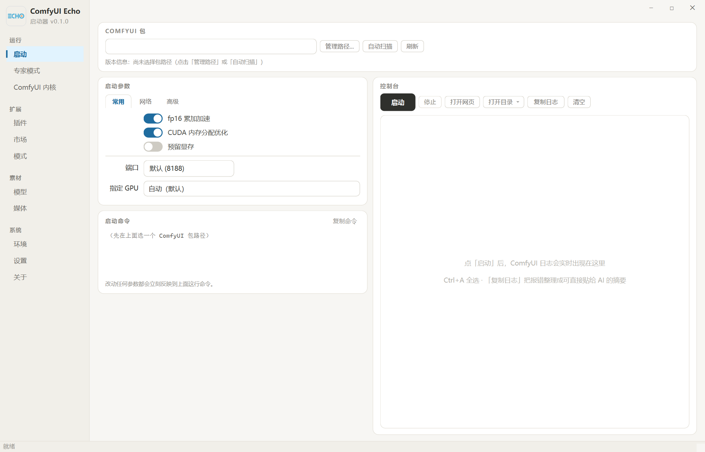
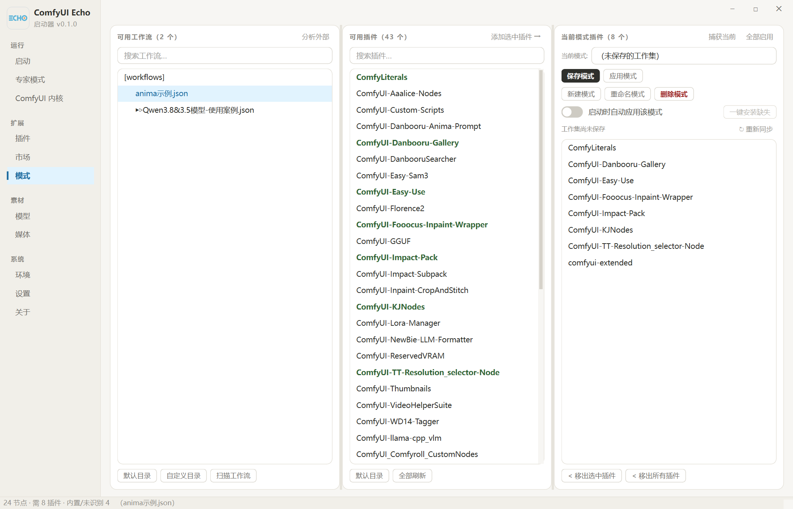
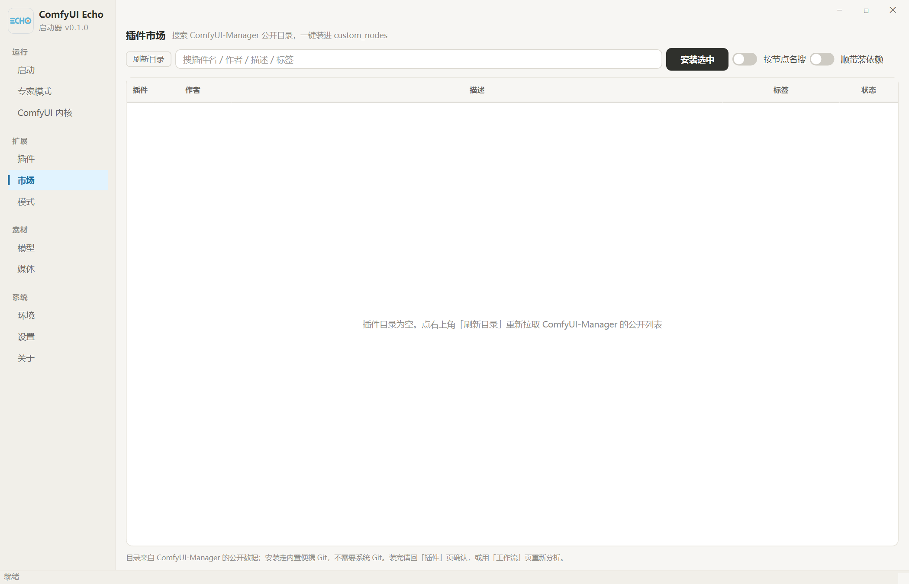
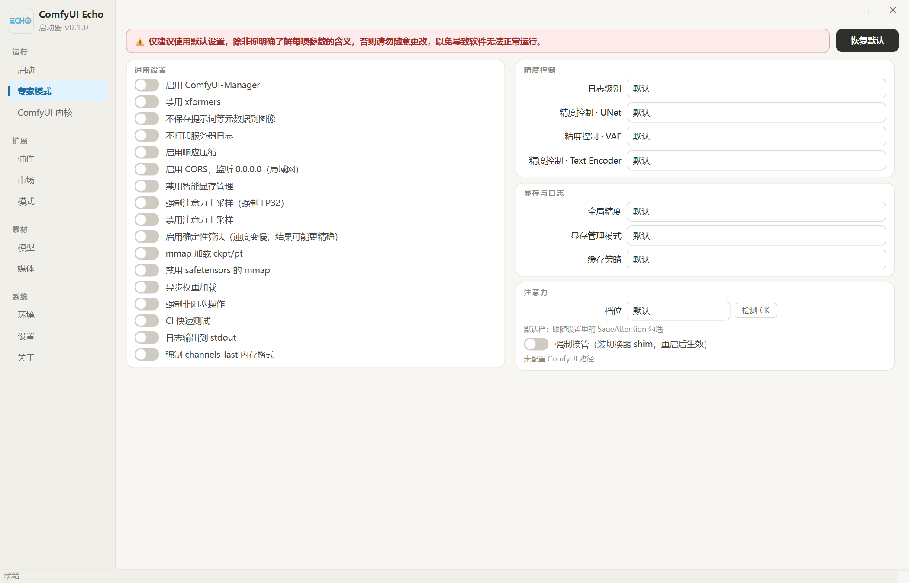

<div align="center">
  
  <h1>ComfyUI Echo 启动器</h1>
  <p>
    <strong>纯本地运行的 ComfyUI 管理面板</strong><br>
    把 启动 · 插件 · 工作流 · 模型 · 媒体 · 内核版本 收进一个窗口
  </p>
  <p>
    <a href="https://github.com/fatefgo2050/ComfyUI_Echo_Launcher/releases">下载免安装包</a>
    &nbsp;·&nbsp;
    <a href="#主要功能">主要功能</a>
    &nbsp;·&nbsp;
    <a href="#从源码运行">从源码运行</a>
    &nbsp;·&nbsp;
    <a href="#目录结构">目录结构</a>
  </p>
  <p>
    
    
    
    
  </p>
</div>

---

## 这是什么

一台机器上往往有**多套 ComfyUI**：不同的整合包、不同的插件集、不同的 Python 环境。
日常切换靠手动改名插件目录、手敲启动参数，很容易出错。

**ComfyUI Echo 启动器**把这些收进一个窗口：多包路径统一管理、按工作流切换插件集、
启动参数可视化、插件与内核的安装更新、模型与媒体的浏览整理 —— 全部**在本机完成**，
不依赖任何私有服务端。

<br>

<div align="center">
  
  <br><em>启动 —— 多包路径 · 启动参数 · 实时控制台</em>
</div>

## 主要功能

| 分区 | 页面 | 说明 |
|---|---|---|
| 运行 | 启动 | 多包路径、启动参数、**注意力四档**（默认 / SAGE / FLASH / CK INT8）、按显卡名选设备、控制台 |
| 运行 | 专家模式 | ComfyUI 高级启动参数：精度 / 显存 / 日志 / 注意力接管 |
| 运行 | ComfyUI 内核 | 内核版本的查看与切换（只管内核，不含插件） |
| 扩展 | 插件 | 扫描 / 启停 / 更新 / 卸载 / 还原点（`.disabled` 就地重命名，不改 ComfyUI 源码） |
| 扩展 | 市场 | ComfyUI-Manager 公开目录、**输入即过滤**、按节点名反查 |
| 扩展 | 模式 | 工作流 → 插件集：一条链路配好"本次启动启用哪些插件" |
| 素材 | 模型 | 底模 / 用途分类、查重（大小 / 哈希）、备注、Civitai 反查 |
| 素材 | 媒体 | 缩略图网格、生成参数、图片分割对比 / 视频同步播放 |
| 系统 | 环境 | pip 包与重型轮子（torch / SageAttention / xFormers …）、环境快照与还原 |
| 系统 | 设置 | 自更新仓库 / Token / 托盘 / 通知 |
| 系统 | 关于 | 软件介绍与版本更新 |

<br>

<div align="center">
  
  <br><em>模式 —— 工作流 / 插件 / 当前模式一屏三栏，选工作流即知缺哪些插件<br>
  （图为<strong>首次启动的空态</strong>：在「启动」页选好包路径后，左栏会列出你的工作流、中栏高亮它需要的插件）</em>
</div>

<div align="center">
  
  <br><em>市场 —— ComfyUI-Manager 公开目录，边打边过滤、按节点名反查<br>
  （图为<strong>尚未拉取目录的空态</strong>：点右上角「刷新目录」即可加载公开插件列表）</em>
</div>

<div align="center">
  
  <br><em>专家模式 —— 精度 / 显存 / 日志 / 注意力接管，逐项对应命令行开关</em>
</div>

## 下载

| 文件 | 说明 |
|---|---|
| `ComfyUI_Echo_Launcher_v0.1.1_windows-x64.zip` | **免安装**：解压后双击 `ComfyUI Echo启动器.exe` 即可（无需安装 Python） |
| Source code（zip / tar.gz） | GitHub 自动生成，或直接 `git clone` 本仓库 |

- 平台：**Windows 10 / 11（64 位）**。
- 解压后 `ComfyUI Echo启动器.exe` 与 `resources/` **必须保持同级**，不要只把 exe 单独拷走。

## 从源码运行

需要 **Python 3.13（64 位）**：

```bat
python -m venv .venv
.venv\Scripts\python.exe -m pip install -r requirements.txt
.venv\Scripts\python.exe main.py
```

打包发布版（单文件 exe + 外置 `resources/`，产物在 `dist/`）：

```bat
.venv\Scripts\python.exe build_release.py
```

无界面自检与工具：

```bat
.venv\Scripts\python.exe main_cli.py selftest
.venv\Scripts\python.exe main_cli.py scan
```

## 目录结构

```
comfyui_echo/        界面与业务层（PySide6）
  core/              配置 / 路径 / 进程 / 插件 / 节点映射 / 模型 / 媒体 …
  ui/                各页面与全局样式（style.py 是唯一的色板来源）
echo_launcher/       功能内核：配置 / 模式 / Git / 节点映射 / pip / 媒体 / 模型 / 自更新
resources/           图标与小资产（随包二进制见发布 ZIP）
tests/               UI 冒烟 + 最小尺寸 + 端到端自检
main.py              图形界面入口
main_cli.py          无界面子命令
build_release.py     打包发布版
```

## 数据与隐私

不依赖任何私有服务端：插件索引直连公开 JSON，模型信息走公开接口；全部数据留在本机，不上传运行信息。
网络出口仅限所列公开数据源，以及你在「设置」里填写的自更新仓库。

## 版本

本仓库对应 **v0.1.1**（tag `v0.1.1`）。更新记录见「关于」页与 [Releases](https://github.com/fatefgo2050/ComfyUI_Echo_Launcher/releases)。
